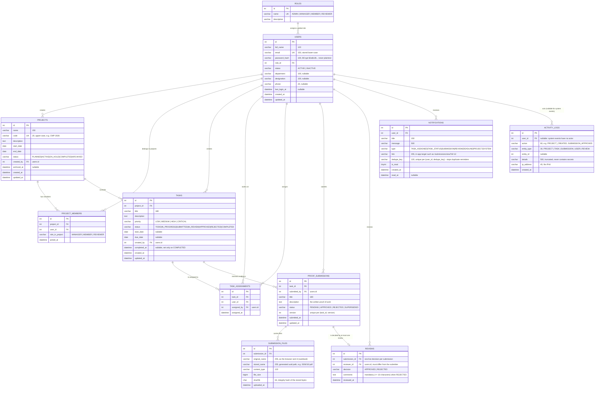

# WorkProof — Database Design (ERD)

Database name: **`workproof`** · Engine: **InnoDB** · Charset: **utf8mb4 / utf8mb4_general_ci**
DDL: [`database/schema.sql`](../database/schema.sql) · demo data: [`database/seed.sql`](../database/seed.sql)

---

## 1. Entity-relationship diagram



## 2. Views

| View | Purpose |
|---|---|
| `v_project_progress` | Per-project roll-up used by the dashboard and the project list: total tasks, completed, approved, awaiting verification, rejected, overdue, and `progress_percent`. Keeping the aggregate here means the JSPs never contain arithmetic or SQL. |

## 3. Keys, constraints and delete rules

| Table | Unique keys | Foreign keys (`ON DELETE` / `ON UPDATE`) |
|---|---|---|
| `roles` | `name` | — |
| `users` | `email` | `role_id → roles.id` **RESTRICT / CASCADE** |
| `projects` | `code` | `created_by → users.id` **RESTRICT / CASCADE** |
| `project_members` | `(project_id, user_id)` | `project_id → projects.id` **CASCADE**; `user_id → users.id` **CASCADE** |
| `tasks` | — (indexed on `(project_id, status)`, `due_date`) | `project_id → projects.id` **CASCADE**; `created_by → users.id` **RESTRICT** |
| `task_assignments` | `(task_id, user_id)` | `task_id → tasks.id` **CASCADE**; `user_id → users.id` **CASCADE**; `assigned_by → users.id` **RESTRICT** |
| `proof_submissions` | `(task_id, version)` | `task_id → tasks.id` **CASCADE**; `submitted_by → users.id` **RESTRICT** |
| `submission_files` | — | `submission_id → proof_submissions.id` **CASCADE** |
| `reviews` | `submission_id` | `submission_id → proof_submissions.id` **CASCADE**; `reviewer_id → users.id` **RESTRICT** |
| `notifications` | `(user_id, dedupe_key)` | `user_id → users.id` **CASCADE** |
| `activity_logs` | — | `user_id → users.id` **SET NULL** (the audit trail survives a deleted account) |

**Why these rules**

* Deleting a **project** takes its membership rows, tasks, submissions and files with it — which is
  why the application offers *archiving* instead of deletion for real work.
* Deleting a **user** is not offered in the UI at all (accounts are deactivated); `RESTRICT` on
  the "author" columns means the database refuses to orphan authored content even if somebody
  writes a raw `DELETE`.
* The **unique key on `(user_id, dedupe_key)`** is what makes the deadline reminder job idempotent:
  the same reminder cannot be inserted twice, and `INSERT IGNORE` turns a duplicate into a no-op.

## 4. Design decisions worth defending in the viva

1. **Normalised to 3NF.** Every table has a single purpose; no repeating groups, no comma-joined
   `member_ids` columns (that is why `project_members` and `task_assignments` exist as separate
   tables with their own keys).
2. **Status columns are `VARCHAR`, not `ENUM`.** The allowed values live in Java enums
   (`TaskStatus`, `ProjectStatus`, …) and in the validation layer. Changing a workflow step becomes
   a one-line Java change instead of an `ALTER TABLE` that rewrites the whole table.
   `TaskStatus.allowedNext()` is unit-tested, so the rule lives in exactly one place.
3. **`role_id` is a foreign key, not a role name string**, so a role can be renamed without touching
   `users`.
4. **Two levels of authorisation in the data model**: the global `users.role_id`
   (ADMIN/MANAGER/MEMBER/REVIEWER) and the per-project `project_members.role_in_project`
   (MANAGER/MEMBER/REVIEWER). A user can manage one project and merely belong to another; the
   queries scope rows using the second table, never the first.
5. **Evidence is versioned, never overwritten.** `(task_id, version)` is unique and older versions
   stay in the table, so "show me the history of this task" is a plain `ORDER BY version` and the
   reviewer's decision on v1 is never silently rewritten.
6. **Files are described, not stored, in the database.** `submission_files` holds metadata only; the
   bytes live in the configured upload directory outside the web root. `stored_name` is generated
   by the server (never the browser's filename) and `sha256` proves the bytes did not change.
7. **Indexes match the real queries**: `tasks(project_id, status)` for the project task list,
   `tasks(due_date)` for the deadline job and upcoming-deadline panels,
   `proof_submissions(status)` and `proof_submissions(submitted_at)` for the review queue and the
   turnaround report, `notifications(user_id, is_read)` for the bell badge,
   `activity_logs(entity_type, entity_id)` for a record's history and `activity_logs(created_at)`
   for the log page — which default-sorts newest first.

## 5. Reproducing the database from scratch

```bash
mysql -u root -p < database/schema.sql              # idempotent: drops and recreates the tables
mysql -u root -p workproof < database/seed.sql      # demo scenario (destroys existing rows)
```

`seed.sql` inserts the same scenario used in the viva: 7 accounts (BCrypt cost 12), 2 projects,
9 tasks covering every status, 5 submissions in every state, 4 reviews, 10 notifications and 20
activity-log rows. Its header comment lists the logins and passwords.
